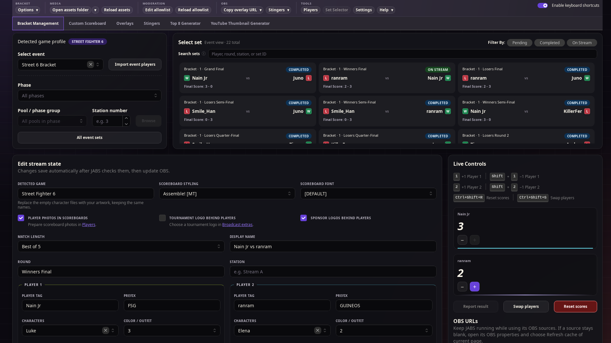
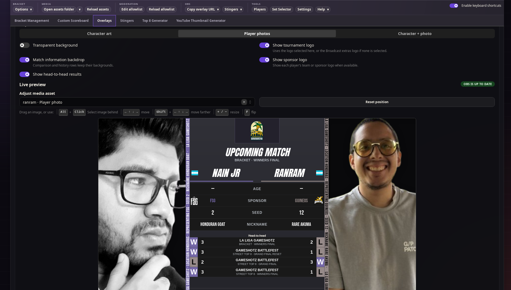
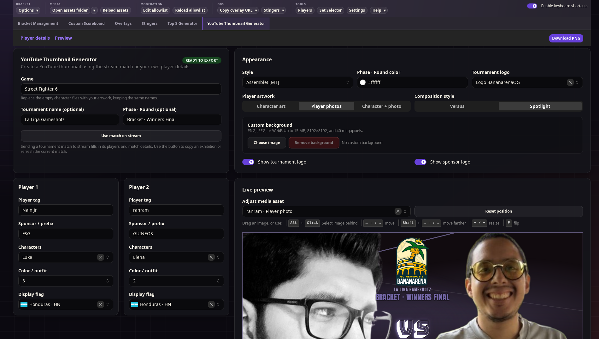
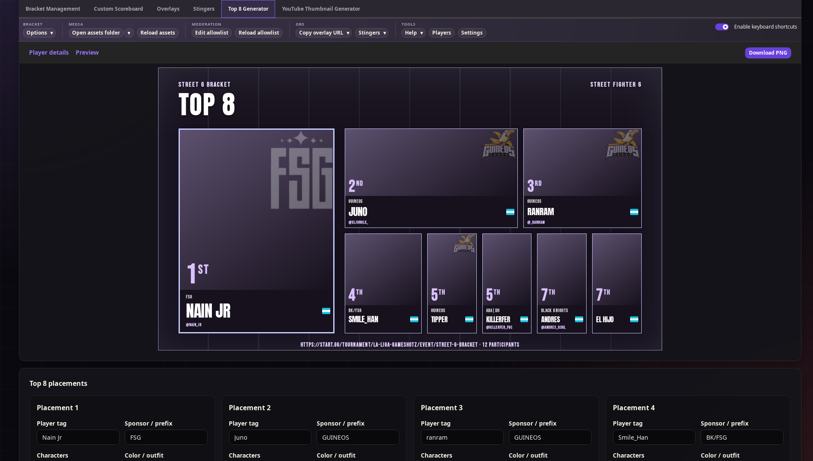

# JABS: Just Another Bracketing System

JABS helps fighting game organizers run tournaments and broadcasts from their computer. It loads brackets from [start.gg](https://www.start.gg/), keeps the current match ready for stream, updates scores, and sends transparent overlays to OBS.

It is designed for organizers handling the bracket and stream themselves, with tools for match reporting, broadcast graphics, and match-upload thumbnails.

Public brackets work without a token. Reporting results requires a start.gg token and confirmation. Settings, player profiles, and media stay on your computer.

## What JABS can do

- Browse start.gg brackets, send matches to stream, and report results.
- Run exhibitions, including first-to matches and Topanga Rules.
- Show live scoreboards, match previews, results, player stats, brackets, and commentators in OBS.
- Save player profiles, photos, and character choices for future matches.
- Customize your overlays with local artwork, fonts, logos, and scoreboard frames.
- Play Perfect and Winner stingers with player artwork.
- Create Top 8 graphics and YouTube thumbnails from tournament results or your own matchups.

The interface includes English and Latin American Spanish, with a separate language choice for OBS.

## Install

Download a package for your operating system from [Releases](https://github.com/ranram/jabs/releases). In-app updates are available for supported release packages.

## Screenshots

<table>
  <tr>
    <td width="50%"><strong>Bracket and stream controls</strong><br></td>
    <td width="50%"><strong>Versus Screen</strong><br></td>
  </tr>
  <tr>
    <td width="50%"><strong>YouTube thumbnail generator</strong><br></td>
    <td width="50%"><strong>Top 8 generator</strong><br></td>
  </tr>
</table>

## Supported games

JABS includes built-in scoreboard styles and game rules for:

- Street Fighter 6
- Tekken 8
- Avatar Legends
- MARVEL Tōkon: Fighting Souls
- Guilty Gear Strive
- 2XKO
- BlazBlue Centralfiction
- Fatal Fury: City of the Wolves
- Granblue Fantasy Versus: Rising
- The King of Fighters XV
- Melty Blood: Type Lumina
- Mortal Kombat 1
- Ultimate Marvel vs. Capcom 3
- Super Smash Bros. Ultimate
- Under Night In-Birth II Sys:Celes

Other fighting games are available through the searchable **Game** list or their start.gg events. They can use an existing rules profile while keeping their own game name and artwork.

## Get started

1. Load a start.gg tournament URL or slug, choose an event, and send a set to stream. For exhibitions, choose a game and enter the players directly.
2. Copy a URL from **OBS URLs** in the toolbar into an OBS Browser Source at `1920×1080`.
3. Keep JABS running and update scores from **Edit stream state**.

Choose **Help** for in-app tutorials. The [User Manual](USER_MANUAL.md) covers artwork, overlays, and [connecting to start.gg for reporting](USER_MANUAL.md#connect-to-startgg).

## Develop

Requires Node.js `24.15.0` or newer, pnpm `11.18.0`, Rust `1.97.1` or newer, and the [Tauri 2 platform prerequisites](https://v2.tauri.app/start/prerequisites/). Linux also requires WebKitGTK `2.52.3` or newer.

```sh
pnpm install --frozen-lockfile
pnpm run dev
```

See the [Technical Manual](TECH_MANUAL.md) for architecture, contributor checks, and source builds.

## License and support

Original code and documentation use [Apache 2.0](LICENSE). See [third-party notices](THIRD_PARTY_NOTICES.md) and [asset licensing](ASSET_LICENSES.md) for other material, and [SECURITY.md](SECURITY.md) to report a vulnerability.

For help, use **Help → Diagnostics & support** in JABS or email **akatsatech@gmail.com**.

Support development through [Ko-fi](https://ko-fi.com/ranram).
